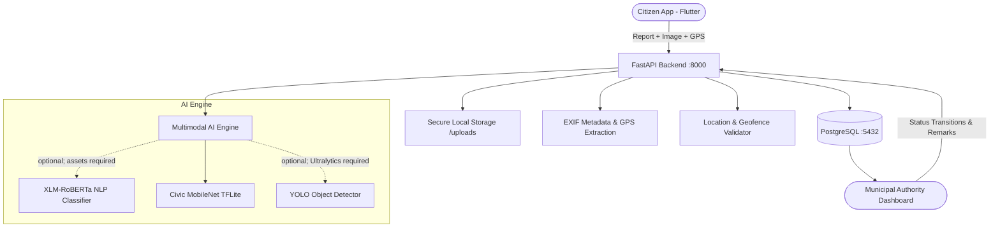

# Civic Intelligence Platform 🏙️

An end-to-end civic engagement and municipal resolution platform focused on
Wagholi and Pune. Citizens can report neighborhood issues with photos, GPS
coordinates, and descriptions. The backend validates locations, extracts EXIF
metadata, runs the available TFLite image classifier, and routes reports to
municipal authorities for review and resolution. Missing AI models are reported
as unavailable; the service does not fabricate predictions.

---

## Architecture Overview



---

## Key Features

1. **Citizen Experience**:
   - Authentication (Registration, JWT Login, Password Reset, Secure Session).
   - Issue reporting with camera capture or gallery selection.
   - GPS coordinate acquisition and address geocoding.
   - Image-based AI category suggestion when the TFLite model is available.
   - Feed of community issues, personal submitted reports ("My Reports"), and interactive map.
   - Community upvoting (strictly 1 vote per user) and discussion comments.

2. **Civic AI Engine**:
   - **Civic TFLite image classifier**: Runs real predictions for supported image categories and exposes confidence as model confidence, not accuracy.
   - **Text classifier**: Integration reports unavailable because the XLM-RoBERTa model/tokenizer assets are not in the repository.
   - **YOLO object detection**: Weights exist, but `ultralytics` is missing from the backend environment.
   - AI failure does not prevent a citizen from submitting a report.

3. **Image & Location Pipeline**:
   - MIME validation (JPEG, PNG) and file size limits (configurable, default 10MB).
   - Safe UUID filename generation preventing directory traversal attacks.
   - EXIF GPS extraction (`DateTimeOriginal`, GPS coordinates in decimal degrees).
   - **Location Validation Engine**:
     - `VALID`: Coordinates inside jurisdiction and consistent with photo EXIF.
     - `MISSING_METADATA`: Photo lacks GPS (report is accepted and marked for manual review).
     - `FLAGGED_FOR_REVIEW`: Photo EXIF GPS differs from submitted device GPS beyond threshold (default 500m) or is outside municipal target boundary.
     - `INVALID`: Malformed or out-of-range latitude/longitude.

4. **Municipal Governance & Administrative Portal**:
   - Real-time municipal dashboard displaying jurisdiction stats (Total, Submitted, Verified, In Progress, Resolved, Rejected, Flagged).
   - Category distribution statistics.
   - Filterable report management table.
   - Formal status transition workflows:
     - `SUBMITTED` ➔ `VERIFIED` ➔ `IN_PROGRESS` ➔ `RESOLVED` / `REJECTED` / `FLAGGED`.
   - Immutable audit logging: every status transition records a `ReportStatusLog` with timestamp, officer identity, and official remark.

---

## Technology Stack

- **Backend**: FastAPI, Python 3.12/3.14, SQLAlchemy 2.0, Alembic, Pydantic v2, Python-Jose (JWT), Passlib (Bcrypt).
- **Database**: PostgreSQL 17 (Docker container `civic_postgres`).
- **AI / ML**: PyTorch, HuggingFace Transformers (XLM-RoBERTa), Google LiteRT / TFLite, Ultralytics YOLOv8, Pillow.
- **Frontend**: Flutter 3.47 (Dart 3.13), Flutter Riverpod, GoRouter, Dio, Flutter Secure Storage, Google Maps Flutter, Geolocator, Image Picker.
- **DevOps**: Docker, Docker Compose, Pytest.

---

## Project Structure

```
├── backend/
│   ├── app/
│   │   ├── api/v1/endpoints/  # Auth, Reports, Municipality, AI
│   │   ├── core/              # Config, Security, Roles, Constants
│   │   ├── dependencies/      # DB, Auth, Role guards
│   │   ├── models/            # SQLAlchemy models (User, Report, Media, StatusLog, Comment, Upvote)
│   │   ├── schemas/           # Pydantic validation schemas
│   │   ├── services/          # ReportService, AIService, ExifService, LocationService, StorageService
│   │   └── validators/        # Image & Location validators
│   ├── migrations/            # Alembic database migrations
│   ├── tests/                 # Full pytest suite (Auth, Reports, Upload, Location, AI)
│   └── uploads/               # Safe local media storage
├── frontend/
│   ├── lib/
│   │   ├── app/router/        # GoRouter routes and auth redirect guards
│   │   ├── core/              # ApiClient, TokenStorage, AppColors, ApiConstants
│   │   ├── features/
│   │   │   ├── auth/          # Login, Register, Forgot Password
│   │   │   ├── feed/          # Home Dashboard, My Reports, Report Detail
│   │   │   ├── post/          # Create Report (Camera, GPS, AI Suggestion)
│   │   │   ├── maps/          # Interactive map & proximity list
│   │   │   └── municipality/  # Admin Portal, Stats, Status Transitions
│   │   └── shared/models/     # Data models with JSON deserialization
│   └── test/                  # Widget and model unit tests
├── ai/
│   ├── model/                 # civic_model.tflite and labels.txt
│   └── test_images/           # Sample test images for validation
└── docker-compose.yml         # PostgreSQL and Backend orchestration
```

---

## Setup & Getting Started

### AI model availability

The repository includes `ai/model/civic_model.tflite` and `labels.txt`; this
image classifier was loaded and run against a repository sample image. The
`ai/nlp/civic_nlp_model/` weights/tokenizer directory is absent, so text
classification reports unavailable and does not invent a result. YOLO weights
are present, but object detection reports unavailable until `ultralytics` is
installed in the backend environment.

### 1. Prerequisites
- Docker & Docker Compose
- Python 3.11+ / Python 3.12
- Flutter SDK 3.24+ (Installed on system)

### 2. Environment Variables
Create `backend/.env` with local credentials (do not commit it). Backend settings
force all development connections to `civic_db_test` on `127.0.0.1:5432` as
`civic_user`, even if a supplied URL names another database:
```env
APP_NAME="Civic Intelligence Platform"
APP_VERSION="1.0.0"
DEBUG=false

# PostgreSQL Connection
DATABASE_URL=postgresql+psycopg://civic_user:<local-password>@127.0.0.1:5432/civic_db_test

# JWT Security
JWT_SECRET_KEY=your-secure-jwt-secret-key-at-least-32-chars
JWT_ALGORITHM=HS256
ACCESS_TOKEN_EXPIRE_MINUTES=120

# Storage & Uploads
UPLOAD_DIR=uploads
MAX_UPLOAD_SIZE_BYTES=10485760

# Location Geofence (Pune Urban Area)
CIVIC_TARGET_CITY=Pune
CIVIC_LAT_MIN=18.25
CIVIC_LAT_MAX=18.75
CIVIC_LON_MIN=73.65
CIVIC_LON_MAX=74.15
LOCATION_DISCREPANCY_THRESHOLD_METERS=500.0
```

### 3. Database & Migrations
To use the optional isolated Docker test server, set `CIVIC_DB_TEST_PASSWORD`
to the same local password used in `backend/.env`, then start the dedicated
test service. It uses a new `civic_test_postgres_data` volume and never mounts
the historic `postgres_data` volume:
```bash
docker compose up -d postgres_test
```

Or use a local PostgreSQL server with database `civic_db_test` and role
`civic_user`. Initialize the database only if it does not exist, then apply the
checked-in migration chain:

```bash
cd backend
../ctp_env/bin/python scripts/ensure_test_database.py
../ctp_env/bin/alembic upgrade head
```

### 4. Running the Backend
From the project root:
```bash
cd backend
../ctp_env/bin/uvicorn app.main:app --host 0.0.0.0 --port 8000 --reload
```
The API docs are at `http://localhost:8000/docs`; `/health` confirms the
database connection and verifies the selected database is `civic_db_test`.
Copy `backend/.env.example` to `backend/.env`, replace the local PostgreSQL and
JWT placeholders, and add the web development origin to `CORS_ORIGINS` when
serving the web client from a different origin. Never commit `backend/.env`.

Seed repeatable sample users, reports, categories, statuses, timestamps, Pune
coordinates, and explicitly synthetic ward labels:
```bash
cd backend
../ctp_env/bin/python scripts/seed_demo_data.py
```

Demo accounts use `demo.citizen1@synthetic.civic.org` through
`demo.citizen6@synthetic.civic.org`, all with password `DemoCivic123!`.
Every generated record is marked synthetic and is not municipal data.

The civic health score is calculated from database issues using these weights:
resolution 30%, handling 20%, unresolved severity 25%, stale pending age 15%,
and repeat reports 10%. The response includes each component and its inputs.
Severity penalties and pending-age penalties are normalized by the active issue
count; repeat-report health uses the share of issues with multiple linked
submissions. Scores are withheld below five active issues in the selected ward
or overall scope instead of treating an empty ward as perfect.
Official ward assignment requires a configured GeoJSON at
`backend/app/data/ward_boundaries.geojson`; demo ward labels are synthetic.

### 5. Running the Flutter Frontend
From the `frontend` directory:
```bash
cd frontend
flutter pub get
flutter run -d chrome --dart-define=API_BASE_URL=http://127.0.0.1:8000
# or create the static web build (set API_BASE_URL in your shell first)
API_BASE_URL=http://127.0.0.1:8000 ./tool/build_web.sh
flutter run -d chrome     # Run on Web
# or
flutter run -d macos      # Run on macOS Desktop
# or
flutter run               # Run on connected iOS/Android device
```

The website is the Flutter web build of the same client and uses the same
FastAPI API, authentication, and database as Android. The public landing page,
registration, sign-in, report flow, complaint explorer/detail, transparency
dashboard, public map/list, and protected authority dashboard share these
routes and APIs. It is not a separate data store or second backend.

### Secure administrator and staff setup

Apply the `civic_db_test` migrations first. From `backend`, create the initial
administrator once:

```bash
../ctp_env/bin/python scripts/create_admin.py
```

The command checks both the configured database and PostgreSQL's
`current_database()`, prompts for an email, and reads the password twice with
hidden input. Choose a unique email and a 12–128 character password; the
password is hashed with the app's existing PBKDF2 password hasher and is never
printed. The first run creates an admin. Later runs refuse to overwrite or
reset any administrator. There is no public admin-registration endpoint.

Sign in through the website's **Administrator / municipal staff sign in** link
(`/admin-login`) or the Flutter app's sign-in screen. Citizen registration does
not grant staff privileges. The protected dashboard remains at `/municipality`.
After login, verify the role on `/api/v1/me` (the response must report
`"role":"admin"`) or open the protected `/api/v1/admin-test`. Additional
municipal or field-worker accounts can be created from a trusted backend shell
with `../ctp_env/bin/python scripts/create_staff.py`; the command requires an
existing admin, accepts only `municipality` or `field_worker`, and prompts for
the password securely. Give staff their temporary credentials through a
private channel and have them change passwords through the secured recovery
flow once mail delivery is configured. Do not create staff through public
registration.

### Google Maps keys

The app uses `google_maps_flutter` on Android and web. In Google Cloud Console,
create a project, attach billing, and enable **Maps SDK for Android** and
**Maps JavaScript API**. Create separate API keys:

1. For Android, set application restriction to **Android apps**, package name
   `com.example.frontend`, and the SHA-1 certificate fingerprint. Get the local
   debug fingerprint from `cd frontend/android && ./gradlew signingReport`.
   Restrict this key to Maps SDK for Android. Put it in the ignored
   `frontend/android/local.properties` as `MAPS_API_KEY=YOUR_ANDROID_KEY`.
2. For web, set application restriction to **Websites** and allow only your
   local origin while developing (for example `http://localhost:5000/*`) plus
   the deployed HTTPS site origin. Restrict the key to Maps JavaScript API.
   Export `MAPS_API_KEY=YOUR_RESTRICTED_BROWSER_KEY` and
   `API_BASE_URL=https://your-api-host` in the local build shell, then run
   `./tool/build_web.sh` from `frontend`. This injects the key into the generated
   browser build only; browser keys are visible to visitors and must remain
   referrer/API restricted.

Without a Maps key, both clients keep the real complaint-location list
available and clearly report that map tiles are unconfigured.

### Physical Android phone on the same Wi-Fi

1. Connect the Mac and phone to the same Wi-Fi network. Find the Mac's private
   IPv4 address in System Settings → Wi-Fi → Details → TCP/IP (for example,
   `192.168.1.24`). Do not use `localhost` or `10.0.2.2` on a physical phone.
2. Start the backend with `--host 0.0.0.0` as above and confirm
   `http://<mac-ip>:8000/health` opens from the phone's browser. Allow incoming
   connections for Python if macOS asks.
3. From `frontend`, run:
   ```bash
   flutter pub get
   flutter run -d <device-id> --dart-define=API_BASE_URL=http://<mac-ip>:8000
   ```
   Find the device ID with `flutter devices`. The Android app allows cleartext
   HTTP for local development; use HTTPS for a deployed backend.
4. To use Google Maps, put `MAPS_API_KEY=<your-restricted-key>` in the ignored
   `frontend/android/local.properties` file. Without a configured Maps key,
   use the app's list view; report submission, feeds, and dashboard APIs do not
   depend on Google Maps.

---

## Testing

### Backend Test Suite
Run the backend unit and integration tests:
```bash
PYTHONPATH=backend ./ctp_env/bin/pytest -v backend/tests
```
Tests cover:
- User registration, duplicate checks, password validation.
- Login and JWT authentication.
- Role-based permissions (Citizen, Municipality, Admin).
- Report creation (JSON & multipart image upload).
- Unauthorized editing prevention.
- Image MIME and size validation, path traversal prevention.
- EXIF GPS extraction and location discrepancy calculations.
- AI NLP text classification, TFLite image inference, multimodal consensus.
- Comments and upvote toggling.
- Municipal statistics.

### Flutter Test Suite
Run Flutter unit and widget tests:
```bash
cd frontend
flutter test
```

Static analysis:
```bash
cd frontend
flutter analyze
```

---

## Complete End-to-End Demo Workflow

1. **Citizen Registration & Login**:
   - Register a new citizen account at `/register` or login at `/login`.
2. **Creating a Report**:
   - Tap **"Report Issue"** (+ button).
   - Enter title and description (e.g., *"Large crater pothole on FC road"*).
   - Attach a photo via Camera or Gallery.
   - Tap **"Detect"** under Multimodal Civic AI — notice the AI model automatically categorizes the grievance as `Pothole/Road Damage` with high confidence!
   - Tap **"Get Current GPS"** to record coordinates.
   - Tap **"Submit Civic Report"**.
3. **Automated Pipeline Processing**:
   - Backend validates image format and saves with a safe UUID in `/uploads`.
   - EXIF data is extracted; location is compared against submitted coordinates.
   - Status is initialized to `SUBMITTED`, initial `ReportStatusLog` is recorded.
4. **Community Engagement**:
   - Citizens can view the report on the Feed or Map.
   - Upvote the issue (enforced 1 upvote per user).
   - Add discussion comments.
5. **Municipal Review & Status Transition**:
   - Municipal officer logs in and visits the **Municipal Governance Portal** (`/municipality`).
   - Reviews live stats and filters jurisdiction issues.
   - Opens report `#1`, inspects AI confidence and location validation status (`VALID`).
   - Clicks **"Update Status"**, selects `VERIFIED` and inputs remark: *"Assigned road inspection unit"*.
   - When roadwork completes, transitions status to `RESOLVED` with remark: *"Tarmac resurfacing completed"*.
6. **Citizen Confirmation**:
   - Citizen opens report detail and sees the updated green `RESOLVED` badge and the complete chronological audit timeline in the **Status Timeline**.
